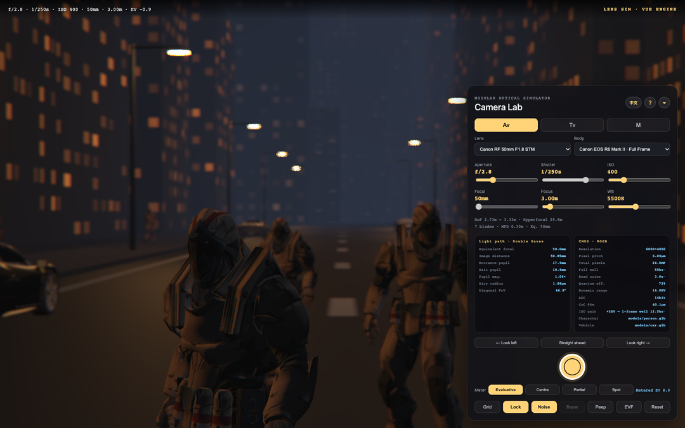

# Lens Sim · Vue Camera Simulator

**Live demo:** https://congduan.github.io/camera-sim/

An interactive camera simulator built with **Vue 3 + WebGL**. It feeds real camera-body sensor parameters and real lens mechanical specifications into a thin-lens optical model, then solves depth of field, out-of-focus bokeh, diffraction and CMOS noise on a per-pixel basis — a hands-on way to understand how aperture, shutter speed, ISO, focal length and focus distance interact.

## Screenshots



*Viewfinder and control panel: Canon RF 50mm F1.8 STM on a Canon EOS R6 Mark II, Av mode. The panel reports live light-path and CMOS readouts while the frame shows real geometric bokeh. The interface switches between English and Chinese.*

## Features

- **Three exposure modes**: `Av` (aperture priority, shutter auto-linked), `Tv` (shutter priority, aperture auto-linked), and `M` (manual, where you can observe over- and under-exposure).
- **Verified equipment library**: body and lens specs come from manufacturer-published data (source links are kept in `src/data/equipment.js`).
  - Lenses: Canon RF 50mm F1.8, EF 70-200mm F2.8L III, EF 16-35mm F2.8L III, NIKKOR Z 85mm F1.2 S, Sony FE 24-70mm F2.8 GM II
  - Bodies: Canon EOS R6 Mark II, EOS 5D Mark IV, EOS 90D
- **Ray-picked focus**: click any object in the frame to focus on it; drag to change the viewing direction; scroll to zoom.
- **Portrait subjects**: three standing figures at 3.4 m, 6.2 m and 9.2 m so every focal length has a subject framed usefully, plus walking pedestrians for the background. Figures come from a rigged character model in `public/models/`, normalised to 1.72 m and animated with `AnimationMixer`; a procedural figure of the same proportions is used when no model is present. Clicking a person snaps the autofocus box onto the face.
- **Parked cars**: a Draco-compressed car model, normalised to 4.53 m, with per-instance paint duplicated so each car keeps its own colour. Orientation is measured from the model rather than hard-coded. The decoder is served from `public/draco/`, and a box car stands in if either the model or the decoder is missing.
- **Depth of field and light path**: live readouts for DoF range, hyperfocal distance, image distance, entrance/exit pupil diameter, pupil magnification and Airy radius.
- **Pixel peep**: renders at true photosensitive-site granularity so you can see the Bayer array (CFA) and photon shot noise; drag to pan the sampling window.
- **Assist tools**: distortion grid, subject lock, CMOS noise toggle, metering patterns, virtual viewfinder, shot preview and JPEG download with EXIF.

## Tech stack

| Layer | Detail |
| --- | --- |
| Framework | Vue 3 (`<script setup>` Composition API) |
| Rendering | three.js `WebGPURenderer`, falling back to WebGL2 (`src/core/webglRenderer.js`) |
| Build | Vite 6 |
| 3D geometry | three.js 0.180 |

## Getting started

```bash
# Install dependencies
npm install

# Start the dev server
npm run dev

# Production build
npm run build

# Preview the build locally
npm run preview
```

The dev server and the preview server both honour the configured `base`, so open
<http://localhost:5173/camera-sim/> instead of the bare port.

## Deployment

The demo is published to GitHub Pages at <https://congduan.github.io/camera-sim/> by
[`.github/workflows/deploy.yml`](.github/workflows/deploy.yml). Every push to `main` installs dependencies,
runs `npm run build` and uploads `dist/` as the Pages artifact; the workflow can also be started manually
from the **Actions** tab.

A project page is served from a sub-path, so `vite.config.js` sets `base: '/camera-sim/'`. Override it when
the site moves to a custom domain or a `<user>.github.io` user page:

```bash
BASE_PATH=/ npm run build
```

### One-time setup

1. Push the project to `main`, including `package-lock.json` — the workflow runs `npm ci`, which requires it.
2. In the repository, open **Settings → Pages** and set **Source** to **GitHub Actions**.
3. Push to `main` again, or run the *Deploy to GitHub Pages* workflow from the **Actions** tab.

## Project structure

```
camera-sim/
├── .github/workflows/
│   └── deploy.yml          # GitHub Pages deployment
├── index.html              # Entry HTML
├── vite.config.js          # Vite configuration
├── LICENSE                 # MIT licence
├── docs/                   # Screenshots used by this README
└── src/
    ├── main.js             # App bootstrap
    ├── App.vue             # Main UI and interaction logic
    ├── styles.css          # Global styles
    ├── data/
    │   └── equipment.js     # Real body / lens specs and sources
    └── core/
        ├── cameraState.js   # Camera state and mode linkage
        ├── constants.js     # Aperture / shutter / ISO stop tables
        ├── exposure.js      # Exposure deviation math
        ├── i18n.js          # English / Chinese interface copy
        ├── optics.js        # Thin-lens light path, DoF, circle of confusion
        ├── sensor.js        # CMOS sensor parameter derivation
        ├── personAsset.js   # Loads and normalises the rigged character model
        ├── vehicleAsset.js  # Loads and normalises the vehicle model
        ├── people.js        # Procedural humanoid fallback
        ├── scene3d.js       # 3D scene geometry
        └── webglRenderer.js # Renderer and per-pixel imaging
```

## Notes

Manufacturers do not publish the actual optical prescriptions of their lenses, so the mechanical and sensor values in `equipment.js` are authoritative spec inputs, while the optical behavior is derived from a thin-lens model calibrated against those public specs. This is an approximate simulation, not a faithful reproduction of an optical design.

Brand and product names are trademarks of their respective owners and are referenced here only to describe the simulated hardware.

## Credits

The character in `public/models/person.glb` is `Soldier.glb` from the [three.js](https://github.com/mrdoob/three.js) examples
(`examples/models/gltf/`), an Adobe Mixamo character. It carries the `Idle`, `Walk` and `Run` clips used for the standing
subjects and the pedestrians.

The car in `public/models/car.glb` is a Ferrari 458 Italia by
[vicent091036](https://sketchfab.com/models/57bf6cc56931426e87494f554df1dab6), also from the three.js examples. Its
geometry is Draco compressed, so the decoder from `three/examples/jsm/libs/draco/gltf/` is copied into `public/draco/`
and served locally.

Note that three.js itself is MIT, but that licence covers the library rather than the bundled third-party assets. Mixamo's
terms govern the character and the car is a Sketchfab upload. Replace either file if you need an unambiguous licence to
redistribute them: see [`public/models/README.md`](public/models/README.md), which also lists CC-BY alternatives.

## License

[MIT](LICENSE)
